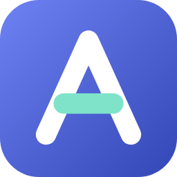
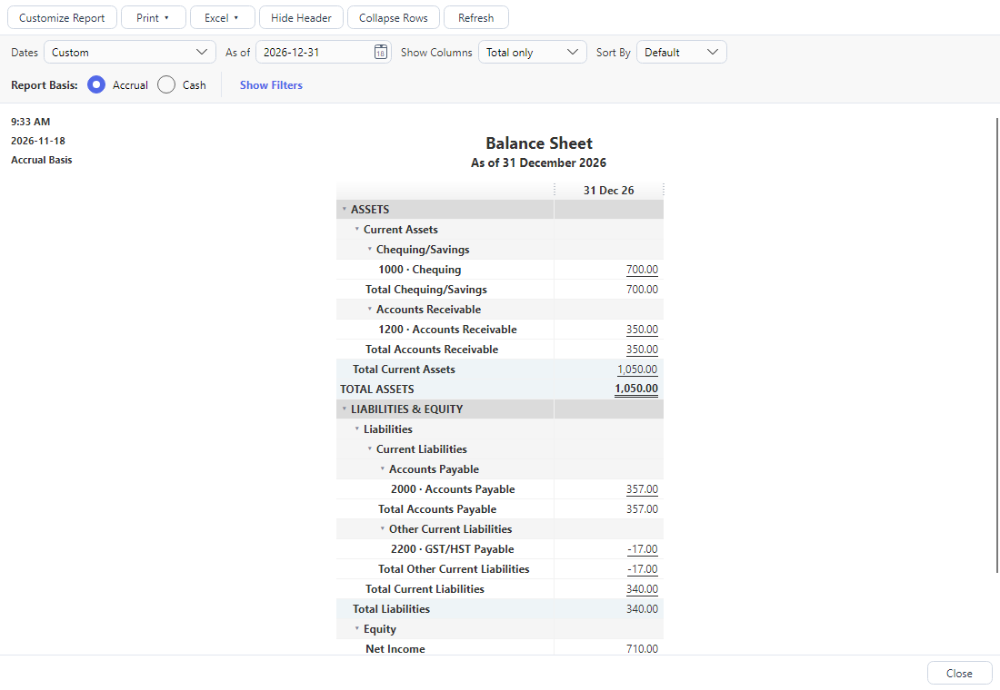

<h1 align="center">AiseWorks Desktop</h1>

Accounting and job management for small Canadian businesses — on your own computer.

This repository is where AiseWorks Desktop is **downloaded**. The software is free to use under its licence
([EULA.txt](EULA.txt)); its source code is not published.

## Download

Go to **[Releases](../../releases/latest)** and download one of:

| File | What it is |
| --- | --- |
| `AiseWorks-Desktop-<version>-Setup.exe` | The installer (recommended). Installs for your Windows account; no administrator rights needed. |
| `AiseWorks-Desktop-<version>-win-x64.zip` | The same app without an installer: unzip anywhere and run `AiseWorks.exe`. |

**Windows SmartScreen.** The installer is not code-signed yet, so Windows may say it "protected your PC". Choose
**More info** > **Run anyway**.

**Requirements:** Windows 10 or 11, 64-bit. Nothing else to install (the .NET runtime is included).

## What it does

- Customers, vendors, jobs and task items; invoices, credit notes, sales receipts and customer statements
- Bills, expenses (cheques), bill payments and refunds; banking, deposits, transfers and reconciliation
- General ledger, journal entries, GST/HST (and PST/QST) set-up, sales tax returns
- Reports in the familiar style: Profit & Loss, Balance Sheet, aging, general ledger and more — drill down to the
  transaction, customize, memorize, print to PDF, export to Excel
- Several companies, one company file each; backups and restores; users and passwords

AiseWorks Desktop is in **alpha**: check its results before relying on them, and keep backups.

## Your data

Your company files, backups and settings stay on your computer (or on a shared folder you choose). Updating or
uninstalling AiseWorks Desktop does not remove them. Back up your company (File > Backup) before installing a new
version.

## Licence

© Taxdeep Corp. All rights reserved. AiseWorks Desktop is licensed under the [End User Licence Agreement](EULA.txt).
It uses open-source components under their own licences: see [THIRD-PARTY-NOTICES.txt](THIRD-PARTY-NOTICES.txt).
